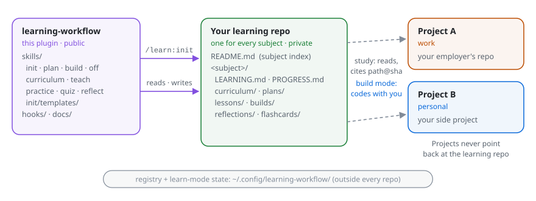
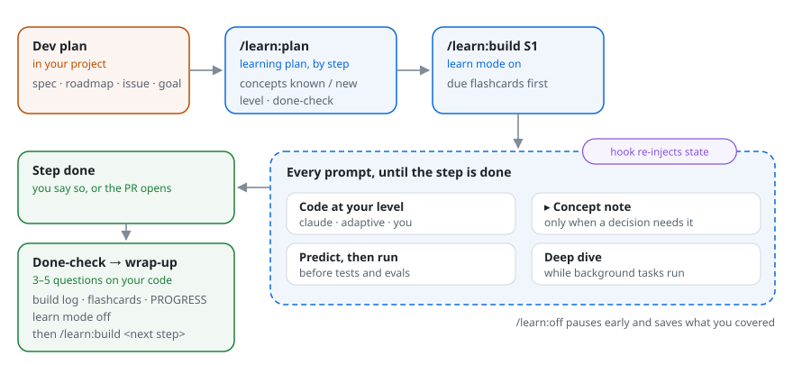
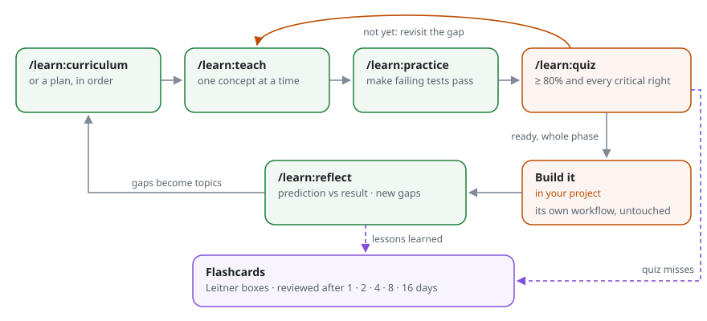

<h1 align="center">Learning workflow</h1>

<p align="center">
  <strong>Learn any subject with <a href="https://docs.anthropic.com/en/docs/claude-code">Claude Code</a>, while you build or before you do.</strong><br/>
  Build mode: code with Claude in your real project and learn what each step needs · Study loop: curriculum, lessons with labs, exercises, quizzes · Spaced repetition and reflection throughout.
</p>

<p align="center">
  <a href="LICENSE"></a>
  <a href="CHANGELOG.md"></a>
  <a href="https://github.com/rafagomes/learning-workflow/actions/workflows/ci.yml"></a>
  <a href="https://github.com/rafagomes/learning-workflow/issues"></a>
</p>

<p align="center">
  <a href="#quick-start">Quick start</a> ·
  <a href="#how-it-works">How it works</a> ·
  <a href="#skills">Skills</a> ·
  <a href="#examples">Examples</a> ·
  <a href="#guarantees">Guarantees</a> ·
  <a href="#documentation">Docs</a>
</p>

---

Asking an assistant to "explain X" gives you an answer you forget by next week. This plugin gives you two ways to actually learn with Claude Code, for **any subject**: Python from zero, Rust ownership, distributed systems, statistics, SQL, music theory.

- **Build mode** (learn while you code). You work on a real step of a real project and keep prompting as usual. Claude codes with you at the hands-on level you choose, stays quiet unless a decision depends on something you haven't learned yet, asks you to predict before running things, uses background waits for short deep dives, and checks what you learned when the step is done.
- **Study loop** (learn before you code). A curriculum from your plan, interactive lessons with runnable labs, exercises with tests, and quizzes.

Your lessons live in **your own learning repo**, which the plugin creates. You can link it to the projects you work on, at your job or on the side, so lessons use real situations from your code while those projects stay free of learning material.

## Quick start

Requires [Claude Code](https://docs.anthropic.com/en/docs/claude-code) and `git`. Labs use whatever toolchain fits the subject ([defaults](skills/init/toolchains.md)).

```bash
claude plugin marketplace add rafagomes/learning-workflow
claude plugin install learn@learning-workflow
```

Learn while building a step of a real project:

```
/learn:init machine-learning ~/code/recsys # learning repo for the subject, project linked
/learn:plan ~/code/recsys/docs/plan.md     # per dev step: concepts you need, who codes, done-check
/learn:build P1                            # learn mode on; now just keep prompting
…                                          # "let's write the candidate generator", "run the eval", …
"P1 is done"                               # 3–5 questions on what you built, wrap-up saved, mode off
```

Or study first:

```
/learn:init python                         # create ~/Learning with a python/ folder, pick level and toolchain
/learn:curriculum "write and test small CLI tools in Python"
/learn:teach python-cli/1                  # first lesson, interactive
/learn:practice 1                          # exercises with failing tests
/learn:quiz python-cli/1                   # are you ready?
/learn:quiz review                         # a few minutes of flashcards, most days
```

## How it works

Two kinds of repo, and one direction of reference:

<picture>
  <source media="(prefers-color-scheme: dark)" srcset="docs/diagrams/repo-model-dark.svg">
  
</picture>

- **This repo** is the method only: skills, templates, docs. No lessons, no learner data.
- **The learning repo** is yours, private by default, and holds every subject you study, one folder each (`~/Learning/python/`, `~/Learning/machine-learning/`, …), with a `README.md` index at the root. It keeps a log of everything in git. Upgrading from v0.1.0, where each subject was its own repo? `/learn:init migrate` folds each one in, history included.
- **Projects** are read-only to the study skills and never point back at the learning repo. In build mode Claude codes in the project with you, under the project's own rules, but plans, logs, notes and learn-mode state stay out of it.
- **Learn mode is per step, and off by default.** `/learn:build <step>` turns it on for that project and the done-check or `/learn:off` turns it off. Its state lives in `~/.config/learning-workflow/active/`, never in the project. See the [FAQ](docs/FAQ.md#how-do-i-turn-learn-mode-on-and-off).

### Build mode

<picture>
  <source media="(prefers-color-scheme: dark)" srcset="docs/diagrams/build-mode-dark.svg">
  
</picture>

| Hands-on level | Claude | You |
|---|---|---|
| `claude` | Writes the code, explains decisions that touch new concepts | Read, ask |
| `adaptive` | Writes plumbing; scaffolds the core with a marked gap for you | Write the core |
| `you` | Plans the next small step, reviews, hints | Write the code |

The default is set per subject; any step or prompt can override it ("I'll write this one").

### The study loop

<picture>
  <source media="(prefers-color-scheme: dark)" srcset="docs/diagrams/study-loop-dark.svg">
  
</picture>

Each topic moves through `todo → learning → practised → ready → built → reflected` (self-assessed topics start as `claimed` and need a passed quiz), tracked in `PROGRESS.md`.

## Skills

| Command | What it does | Writes |
|---|---|---|
| `/learn:init <subject> [project paths…]` | Add a subject folder to the learning repo (creating the repo the first time); ask level, depth, language and toolchain; link projects | `<subject>/`, registry entry |
| `/learn:init add <project path>` | Link another project to a subject | `LEARNING.md`, registry |
| `/learn:plan <spec \| plan \| URL \| goal>` | Link a project's dev plan to a learning plan: per step, the concepts needed (known/new), hands-on level, done-check | `plans/<plan>.md` |
| `/learn:plan <plan>` | Show a plan as a checklist (taught, ready, todo per concept); continue, recheck a concept, or build a step | nothing (read-only) |
| `/learn:build <step> [plan] [level]` | Learn mode on for a step: pair-program at your level, concept notes only when needed, predictions, idle-time deep dives, done-check and wrap-up | `builds/<date>-<step>.md`, flashcards |
| `/learn:off [no-wrapup]` | End learn mode early; the wrap-up is saved unless `no-wrapup` | `builds/` |
| `/learn:curriculum <plan \| spec \| URL \| topic>` | Turn a source into a track of 5–15 topics with prerequisites and checkable "ready when" criteria | `curriculum/<track>.md` |
| `/learn:teach <track>/<n> \| <topic>` | Interactive lesson: problem, intuition, mechanism, a short free video when one helps, lab, project touchpoint, pitfalls, vocabulary, check; a background agent writes and commits it while you keep learning | `lessons/<NNN>-<topic>/lesson.md`, lab, flashcards |
| `/learn:teach <step> \| <plan>` | Study a learning plan in order, one concept per lesson; resumes where you stopped | lessons, `PROGRESS.md` |
| `/learn:practice <topic> [easy\|medium\|hard]` | 2–4 exercises with stubs and failing tests (verified against a hidden reference solution); hints one rung at a time | `exercises/` |
| `/learn:quiz <track>/<n> \| <topic> \| <step> \| <plan> \| <concept>` | 8–12 adaptive questions, one at a time (pick an option or type your own), each answered with Correct, Incorrect or Partly correct first; ready at ≥ 80% with every critical question right | `quiz.md`, flashcards |
| `/learn:quiz review` | Spaced-repetition review of due flashcards | `flashcards/deck.md` |
| `/learn:reflect <topic> [PR \| commit range]` | After building: prediction vs result, gaps, follow-ups | `reflections/<date>-<topic>.md` |

Full reference: [docs/SKILLS.md](docs/SKILLS.md).

## Examples

| You want to… | Start with |
|---|---|
| Learn Python from scratch | `/learn:init python` → `/learn:curriculum "automate my spreadsheets"` |
| Learn Rust while building a side project | `/learn:init rust ~/code/ray-tracer` → `/learn:curriculum ~/code/ray-tracer/PLAN.md` |
| Learn a technique your team is about to adopt | `/learn:init distributed-systems ~/work/payments` → `/learn:curriculum ~/work/payments/docs/design/outbox.md` |
| Build something you don't fully understand yet, and learn as you go | `/learn:plan <spec>` → `/learn:build <step>` |
| Study a plan's concepts before building it | `/learn:plan <spec>` → `/learn:teach <plan>` → `/learn:plan <plan>` to see where you are |
| Learn something with no code | `/learn:init music-theory` (toolchain `none`: worked problems instead of labs) |

Walkthroughs: [docs/EXAMPLES.md](docs/EXAMPLES.md).

## Guarantees

- **Projects stay clean.** Study skills only read projects and cite code as `<project>:path@sha`. Build mode codes in the project at your request under its own rules, and never leaves learning artefacts, `TODO(learner)` scaffolds or references to the learning repo behind.
- **Your employer's data stays out.** Projects are tagged `work` or `personal`. Work code is paraphrased and quoted sparingly; no project data is ever committed. Real samples go only in the gitignored `scratch/`; exercises use seeded synthetic data. A pre-commit guard blocks data files, files over 1 MB and, with [gitleaks](https://github.com/gitleaks/gitleaks) installed, secrets. See [docs/DATA-POLICY.md](docs/DATA-POLICY.md).
- **Numbers come from code that ran.** Lessons quote computed output, not recalled figures.
- **Reproducible.** Labs are self-contained, pinned and seeded; every session is a commit; months later `git log` and `PROGRESS.md` show what you learned, from what, in what order.
- **No extra services.** Everything runs inside Claude Code and your local toolchain.

## Documentation

| Doc | Covers |
|---|---|
| [WORKFLOW.md](docs/WORKFLOW.md) | The method and the learning science behind it |
| [ARCHITECTURE.md](docs/ARCHITECTURE.md) | Plugin layout, the shared contract, registry, learn-mode state and hook, learning-repo layout |
| [specs/001_build-mode.md](docs/specs/001_build-mode.md) | Build mode design |
| [SKILLS.md](docs/SKILLS.md) | Every skill: arguments, inputs, outputs, commits |
| [DATA-POLICY.md](docs/DATA-POLICY.md) | What may and may not enter a learning repo, and how it's enforced |
| [EXAMPLES.md](docs/EXAMPLES.md) | Four walkthroughs: three for the study loop, one for build mode |
| [FAQ.md](docs/FAQ.md) | Common questions |
| [toolchains.md](skills/init/toolchains.md) | Default run/test commands per subject |

## Contributing

Issues and PRs welcome; see [CONTRIBUTING.md](CONTRIBUTING.md). This project follows the [Contributor Covenant](CODE_OF_CONDUCT.md).

## License

[MIT](LICENSE)
