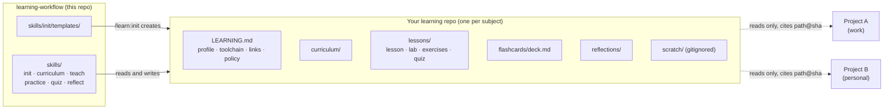
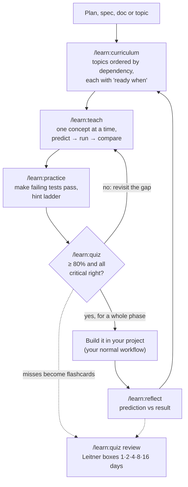

<h1 align="center">learning-workflow</h1>

<p align="center">
  <strong>Learn any subject with <a href="https://docs.anthropic.com/en/docs/claude-code">Claude Code</a> as your tutor, just ahead of what you build.</strong><br/>
  Curriculum from your plan · interactive lessons with runnable labs · tested exercises · quizzes · spaced repetition · reflection on what you shipped.
</p>

<p align="center">
  <a href="LICENSE"></a>
  <a href="CHANGELOG.md"></a>
  <a href="https://github.com/rafagomes/learning-workflow/actions/workflows/ci.yml"></a>
  <a href="https://github.com/rafagomes/learning-workflow/issues"></a>
</p>

<p align="center">
  <a href="#quick-start">Quick start</a> ·
  <a href="#how-it-works">How it works</a> ·
  <a href="#skills">Skills</a> ·
  <a href="#examples">Examples</a> ·
  <a href="#guarantees">Guarantees</a> ·
  <a href="#documentation">Docs</a>
</p>

---

Asking an assistant to "explain X" gives you an answer you forget by next week. This plugin turns Claude Code into a structured tutor: it builds a curriculum from what you are about to do, teaches one concept at a time, makes you predict before it runs anything, checks you with tests and quizzes, and brings ideas back on a spaced-repetition schedule. It works for **any subject**: Python from zero, Rust ownership, distributed systems, statistics, SQL, music theory.

Your lessons live in **your own learning repo**, which the plugin creates. You can link it to the projects you work on, at your job or on the side, so lessons use real situations from your code while those projects stay untouched.

## Quick start

Requires [Claude Code](https://docs.anthropic.com/en/docs/claude-code) and `git`. Labs use whatever toolchain fits the subject ([defaults](skills/init/toolchains.md)).

```bash
claude plugin marketplace add rafagomes/learning-workflow
claude plugin install learn@learning-workflow
```

Then:

```
/learn:init python                         # create ~/Learning/python, pick level and toolchain
/learn:curriculum "write and test small CLI tools in Python"
/learn:teach python-cli/1                  # first lesson, interactive
/learn:practice 1                          # exercises with failing tests
/learn:quiz 1                              # are you ready?
/learn:quiz review                         # a few minutes of flashcards, most days
```

Learning for a project you're building? Link it:

```
/learn:init rust ~/code/ray-tracer         # subject + linked project(s)
/learn:curriculum ~/code/ray-tracer/PLAN.md
```

## How it works

Two kinds of repo, and one direction of reference:



- **This repo** is the method only: skills, templates, docs. No lessons, no learner data.
- **A learning repo** is yours, private by default, one per subject. It holds everything you study and keeps a log of it in git.
- **Projects** are never edited from a learning session and never point back at the learning repo. What you learn reaches them through their own normal workflow.

### The loop



Each topic moves through `todo → learning → practised → ready → built → reflected`, tracked in `PROGRESS.md`.

## Skills

| Command | What it does | Writes |
|---|---|---|
| `/learn:init <subject> [project paths…]` | Create a learning repo; ask level, depth, language and toolchain; link projects | the repo, registry entry |
| `/learn:init add <project path>` | Link another project to an existing learning repo | `LEARNING.md`, registry |
| `/learn:curriculum <plan \| spec \| URL \| topic>` | Turn a source into a track of 5–15 topics with prerequisites and checkable "ready when" criteria | `curriculum/<track>.md` |
| `/learn:teach <track>/<n> \| <topic>` | Interactive lesson: problem, intuition, mechanism, lab, project touchpoint, pitfalls, vocabulary, check | `lessons/<NNN>-<topic>/lesson.md`, lab, flashcards |
| `/learn:practice <topic> [easy\|medium\|hard]` | 2–4 exercises with stubs and failing tests (verified against a hidden reference solution); hints one rung at a time | `exercises/` |
| `/learn:quiz <topic>` | 8–12 adaptive questions, one at a time; ready at ≥ 80% with every critical question right | `quiz.md`, flashcards |
| `/learn:quiz review` | Spaced-repetition review of due flashcards | `flashcards/deck.md` |
| `/learn:reflect <topic> [PR \| commit range]` | After building: prediction vs result, gaps, follow-ups | `reflections/<date>-<topic>.md` |

Full reference: [docs/SKILLS.md](docs/SKILLS.md).

## Examples

| You want to… | Start with |
|---|---|
| Learn Python from scratch | `/learn:init python` → `/learn:curriculum "automate my spreadsheets"` |
| Learn Rust while building a side project | `/learn:init rust ~/code/ray-tracer` → `/learn:curriculum ~/code/ray-tracer/PLAN.md` |
| Learn a technique your team is about to adopt | `/learn:init distributed-systems ~/work/payments` → `/learn:curriculum ~/work/payments/docs/design/outbox.md` |
| Learn something with no code | `/learn:init music-theory` (toolchain `none`: worked problems instead of labs) |

Walkthroughs: [docs/EXAMPLES.md](docs/EXAMPLES.md).

## Guarantees

- **Projects are read-only.** Lessons cite code as `<project>:path@sha`; no learning session edits, commits to or opens PRs in a linked project.
- **Your employer's data stays out.** Projects are tagged `work` or `personal`. Work code is paraphrased and quoted sparingly; no project data is ever committed. Real samples go only in the gitignored `scratch/`; exercises use seeded synthetic data. A pre-commit guard blocks data files, files over 1 MB and, with [gitleaks](https://github.com/gitleaks/gitleaks) installed, secrets. See [docs/DATA-POLICY.md](docs/DATA-POLICY.md).
- **Numbers come from code that ran.** Lessons quote computed output, not recalled figures.
- **Reproducible.** Labs are self-contained, pinned and seeded; every session is a commit; months later `git log` and `PROGRESS.md` show what you learned, from what, in what order.
- **No extra services.** Everything runs inside Claude Code and your local toolchain.

## Documentation

| Doc | Covers |
|---|---|
| [WORKFLOW.md](docs/WORKFLOW.md) | The method and the learning science behind it |
| [ARCHITECTURE.md](docs/ARCHITECTURE.md) | Plugin layout, the shared contract, registry schema, learning-repo layout, state machine |
| [SKILLS.md](docs/SKILLS.md) | Every skill: arguments, inputs, outputs, commits |
| [DATA-POLICY.md](docs/DATA-POLICY.md) | What may and may not enter a learning repo, and how it's enforced |
| [EXAMPLES.md](docs/EXAMPLES.md) | Three end-to-end walkthroughs |
| [FAQ.md](docs/FAQ.md) | Common questions |
| [toolchains.md](skills/init/toolchains.md) | Default run/test commands per subject |

## Contributing

Issues and PRs welcome; see [CONTRIBUTING.md](CONTRIBUTING.md). This project follows the [Contributor Covenant](CODE_OF_CONDUCT.md).

## License

[MIT](LICENSE)
