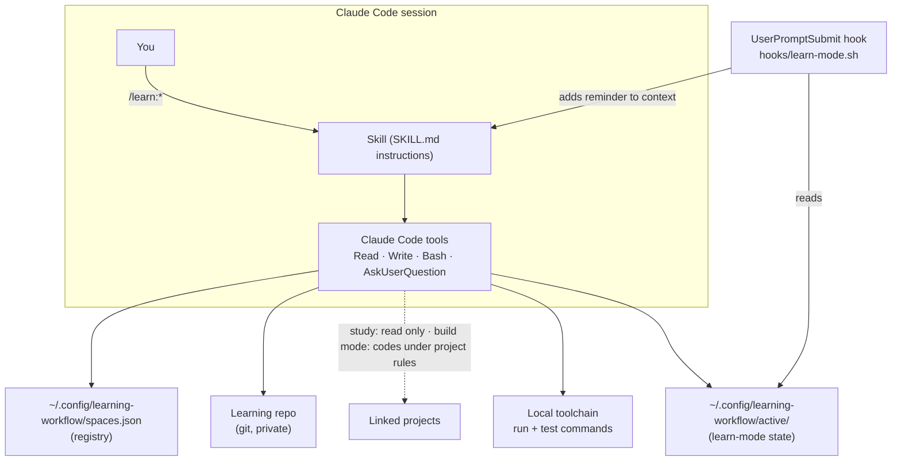

# Architecture

## Components



The plugin is plain Markdown plus one small shell hook: each skill is a `SKILL.md` that Claude Code loads when you run the command. There is no server, daemon or database. State lives in three places: the **registry** (which learning repos exist and which projects they link), the **learn-mode state** (which project has learn mode on, for which step), and each **learning repo** (everything you study).

## Plugin layout

```
.claude-plugin/
  plugin.json             plugin manifest (name: learn)
  marketplace.json        marketplace manifest (name: learning-workflow)
hooks/
  hooks.json              registers the UserPromptSubmit hook
  learn-mode.sh           prints the active learn-mode reminder for this project, else nothing
skills/
  init/
    SKILL.md              create/extend a learning repo; defines the shared contract
    toolchains.md         default run/test commands per subject
    templates/            copied into every new learning repo
      LEARNING.md  PROGRESS.md  CLAUDE.md  gitignore  deck.md  tools/guard.sh  tools/hooks/pre-commit
  plan/SKILL.md           dev plan → learning plan, by step ID
  build/SKILL.md          learn mode for a step
  off/SKILL.md            end learn mode early
  curriculum/SKILL.md
  teach/SKILL.md
  practice/SKILL.md
  quiz/SKILL.md
  reflect/SKILL.md
docs/                     this documentation (specs/ holds feature designs)
tests/                    guard and manifest checks run by CI
```

## The shared contract

Every skill depends on three things, defined once in [`skills/init/SKILL.md`](../skills/init/SKILL.md) and referenced, not restated, by the others:

1. **Resolving the learning repo**, in order: a `LEARNING.md` in the current directory or an ancestor → the registry entry whose linked projects contain the current directory (ask if several) → the only registered entry → ask. None registered → offer `/learn:init`.
2. **The current project**: the linked project containing the current directory, or the one you name.
3. **The data policy** (see [DATA-POLICY.md](DATA-POLICY.md)).

Keeping these in one place means a change to resolution or policy can't silently diverge between skills.

## Registry

`~/.config/learning-workflow/spaces.json`, created on first `/learn:init`:

```json
{
  "spaces": [
    {
      "slug": "rust",
      "path": "/home/me/Learning/rust",
      "created": "2026-11-04",
      "projects": [
        {"slug": "billing-service", "path": "/home/me/work/billing-service",
         "remote": "git@github.com:acme/billing-service.git", "branch": "main", "sensitivity": "work"},
        {"slug": "ray-tracer", "path": "/home/me/code/ray-tracer",
         "remote": null, "branch": "main", "sensitivity": "personal"}
      ]
    }
  ]
}
```

| Field | Meaning |
|---|---|
| `slug` | Subject identifier, also the default directory name |
| `path` | Absolute path of the learning repo |
| `projects[].slug` | Short name used in citations (`<slug>:path@sha`) |
| `projects[].path`, `remote`, `branch` | Where the project lives, its origin (or `null`) and default branch; kept only here, never in git |
| `projects[].sensitivity` | `work` (paraphrase, quote sparingly, never data) or `personal` |

Entries are only ever added or extended by the skills; removal needs your confirmation. The registry lives outside every repo, so neither the learning repo nor any project records the other's path in git.

## Learn-mode state and hook

A skill's instructions can drop out of context when a long session is compacted, so learn mode doesn't rely on them alone:

1. `/learn:build` writes `$LEARNING_WORKFLOW_HOME/active/<key>.md` (default `~/.config/learning-workflow/active/`). `<key>` is the project's git top-level path, or the current directory outside git, with `/` replaced by `_`, so worktrees are separate projects. The hook and the `build`/`off` skills compute the path with one identical shell line (marked `# state-path`), and `tests/hook_test.sh` fails if they drift. The file is a 3-line reminder: step, plan, level, project and sensitivity, the state file's own path, concepts shown and pending, and the condensed rules (including the `TODO(learner)` sweep and the data boundary), so it's self-sufficient after compaction.
2. On every prompt, `hooks/learn-mode.sh` resolves the session's project from the hook input's `cwd`. If that project's file exists and was touched in the last 12 hours, the hook refreshes its timestamp and prints it, and Claude Code adds it to the context. Otherwise it prints nothing.
3. The skill rewrites the file as concepts are shown. The wrap-up and `/learn:off` delete it.

The hook does no parsing beyond reading `cwd`, writes nothing except that timestamp, and never fails a prompt (it always exits 0). `tests/hook_test.sh` covers no state, the active project, subdirectories, other projects, paths with spaces, non-git directories, a missing `cwd`, an unset `HOME`, stale files, the timestamp refresh, and the skill/hook path snippet staying identical. Set `LEARNING_WORKFLOW_HOME` to relocate the state directory. (The `/nonexistent` fallback for an unset `HOME` applies in bash; zsh fills `HOME` from the passwd entry. `HOME` is set in any normal session.)

## Learning repo layout

```
LEARNING.md          identity: learner profile, toolchain, linked projects (slug + sensitivity only), data policy + exceptions
PROGRESS.md          tracks, per-topic status, session log
CLAUDE.md            rules for any Claude session opened inside the learning repo
curriculum/<track>.md
plans/<plan>.md      learning plan, linked by step ID to a project's dev plan
builds/<date>-<step>.md   build-mode log: concepts met, predictions, done-check
lessons/<NNN>-<topic>/
  lesson.md          written during /learn:teach
  lab.<ext>          runnable demonstration (toolchain), or a worked problem
  exercises/<NN>-<slug>/
    README.md        task (no solution)
    <stub>           the file you edit
    <tests>          fail on the stub, pass on a correct solution
    data/            seeded synthetic data, the only place data files may be committed
  quiz.md            questions, answers summarised, score, gaps
flashcards/deck.md   Leitner deck
reflections/<date>-<topic>.md
scratch/             gitignored: real samples, reference solutions, throwaway
tools/guard.sh       pre-commit guard; tools/hooks/pre-commit runs it
```

## Skill I/O

| Skill | Reads | Writes | Commit |
|---|---|---|---|
| init | registry, project manifests | learning repo, registry | `chore: initialize <slug> learning repo`, `chore: link <project>` |
| plan | dev plan + code it touches (read-only), `PROGRESS.md` | `plans/<plan>.md`, `PROGRESS.md` | `docs: learning plan <plan>` |
| build | plan step, deck, project (works in it under its own rules) | active state file; `builds/`, plan, deck, `PROGRESS.md` | `docs: build log <step>` |
| off | active state file | `builds/`, plan, `PROGRESS.md`; deletes state | `docs: build log <step>` |
| curriculum | source (file, URL, spec, issue), `LEARNING.md`, `PROGRESS.md` | `curriculum/<track>.md`, `PROGRESS.md` | `docs: add <track> curriculum` |
| teach | curriculum entry, linked project (read-only) | `lessons/<NNN>-<topic>/`, deck, `PROGRESS.md` | `docs: lesson <NNN> <topic>` |
| practice | lesson | `exercises/`, deck, `PROGRESS.md` | `feat: exercises for <topic>` |
| quiz | curriculum, lesson, deck | `quiz.md`, deck, `PROGRESS.md` | `docs: quiz <topic>` / `docs: flashcard review` |
| reflect | PR or commit range (read-only), lesson, quiz | `reflections/`, curriculum, deck, `PROGRESS.md` | `docs: reflect on <topic>` |

## Enforcement

The pre-commit guard (`tools/guard.sh`, run by `tools/hooks/pre-commit`, which `/learn:init` enables with repo-local `git config core.hooksPath tools/hooks` so a global hooks path can't bypass it) checks the **staged** content of every commit, renames included, and blocks:

- data-like files (`csv`, `parquet`, `json`, `sqlite`, `xlsx`, model artefacts, …, any case) outside `lessons/*/exercises/*/data/`, except common config files (`package.json`, `tsconfig*.json`, …);
- any file over 1 MB;
- anything [gitleaks](https://github.com/gitleaks/gitleaks) flags, when it's installed.

The guard is a seatbelt, not the policy: the skills also follow the policy when they write. `tests/guard_test.sh` exercises the guard in CI.

## Design decisions

| Decision | Alternatives | Verdict |
|---|---|---|
| Learning repo separate from projects | A `learning/` folder in each project | Separate: keeps team history clean, spans several projects, survives leaving a job |
| One repo per subject, many projects | One repo per project | Per subject: what you learn about Rust on project A is the same Rust on project B |
| Registry outside git | Paths committed in the learning repo | Outside: `LEARNING.md` names projects by slug and sensitivity only, so no absolute paths or work remotes reach a repo you might publish |
| Toolchain recorded per repo | Hard-coded language | Per repo: the same skills teach Python, Rust, SQL or music theory |
| Plain Markdown state | A database or app | Markdown + git: diffable, portable, readable without the plugin |
| Learn mode backed by a hook + state file | Rely on the skill staying in context | Hook: survives compaction and long sessions; silent everywhere else |
| Learn mode keyed by project path | Keyed by session ID | Project path: the skill can compute it, worktrees isolate parallel sessions; a skill can't read its own session ID |
| Leitner boxes | SM-2 / FSRS scheduling | Leitner: simple enough to keep in a Markdown file and reason about; good enough for a personal deck |
