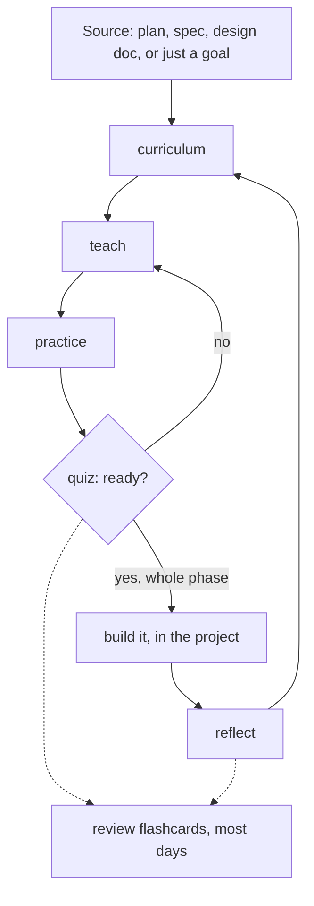
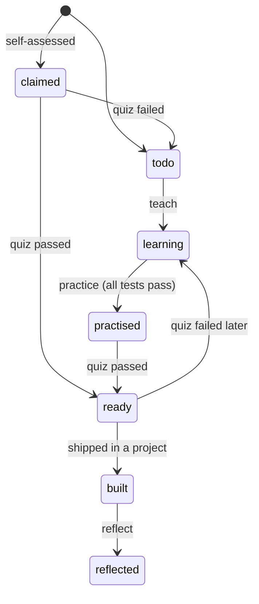

# The learning workflow

## The problem

Learning while you work usually looks like this: you hit something unfamiliar, ask for an explanation, nod along, and move on. A week later it's gone, and you can't tell what you actually understand from what you only recognise. The opposite extreme, a course, teaches things in an order that has nothing to do with what you need next.

This workflow sits between the two. It teaches **what your next piece of work needs, in the order you'll need it**, and it checks that you can *do* each thing, not just that you've read about it.

## Why a separate learning repo

Learning material is personal, exploratory and full of half-right attempts. Project repos are shared, reviewed and must stay clean. Keeping them apart:

- lets you study freely without polluting a team's history or exposing your gaps in a work repo;
- lets one subject draw on several projects at once: a pattern met at work can be practised on a side project;
- keeps the lessons with you when you leave a job or archive a project.

| Repo | Holds | Visibility |
|---|---|---|
| `learning-workflow` (plugin) | The method: skills, templates, docs | Public |
| Learning repo, one per subject | Your curriculum, lessons, exercises, deck, reflections | Private by default |
| Projects | Real code and data, unchanged | As they were |

The learning repo reads projects; nothing reads the learning repo. Anything you learn that should reach a project is rewritten there through that project's own workflow (spec, branch, PR, review).

## The loop

1. **Curriculum.** The source is split into topics ordered by dependency, each tied to the phase that needs it, each with 2–3 observable "ready when" abilities. A short self-assessment skips what you already know (it gets a quiz instead of a lesson).
2. **Teach.** One concept at a time, with a question after each step. Before every lab run you predict the result. The lesson file is written as you go, so it records the explanation that actually worked for you.
3. **Practice.** Exercises with stubs and failing tests. The tests are checked against a hidden reference solution first, so a green run means you're right. Hints come one rung at a time; the solution only if you ask.
4. **Quiz.** Adaptive, one question at a time, mixing explain, predict-the-output, spot-the-bug and choose-and-justify. Ready means ≥ 80% **and** every critical question right.
5. **Build.** In the real project, with its normal process. The plugin stays out of it.
6. **Reflect.** What you predicted, what happened, why they differed, what to do differently. New gaps become new topics.
7. **Review.** Misses and key ideas become flashcards, reviewed on a Leitner schedule.

## The principles, and the evidence behind them

| Principle | How the skills apply it | Why |
|---|---|---|
| **Learn just in time** | Topics come from the plan you're about to execute | Motivation and transfer are highest when the use is immediate |
| **Predict, then run** | Every lab and many quiz items ask for a prediction first | Generating an answer before seeing it (the *generation effect*) and confronting a wrong prediction both improve retention |
| **Retrieval over rereading** | Quizzes, flashcards, "check" questions | *Retrieval practice* (the testing effect) beats rereading for long-term retention |
| **Spaced repetition** | Leitner boxes at 1, 2, 4, 8, 16 days | Spacing reviews out beats massing them (the *spacing effect*) |
| **One concept at a time** | Socratic pacing, a check after each step | Limits cognitive load; misconceptions are caught early |
| **Mastery gates** | "Ready when" + quiz threshold before building | Moving on with gaps compounds them |
| **Reflection** | Prediction-vs-result after every build | Turns experience into transferable lessons |
| **Numbers come from code** | Labs print what the lesson quotes | You never memorise a figure the tutor made up |

Further reading: Brown, Roediger & McDaniel, *Make It Stick* (2014); Dunlosky et al., "Improving Students' Learning With Effective Learning Techniques", *Psychological Science in the Public Interest* (2013).

## Statuses

## Reproducibility

- Labs are self-contained programs in the repo's toolchain, with pinned dependencies and seeded data.
- Project citations carry a commit sha, so a lesson still points at the code it described after the project moves on.
- Every skill ends with a conventional commit, so the history is your learning log.
- `PROGRESS.md` is the one-page answer to "where am I?".
