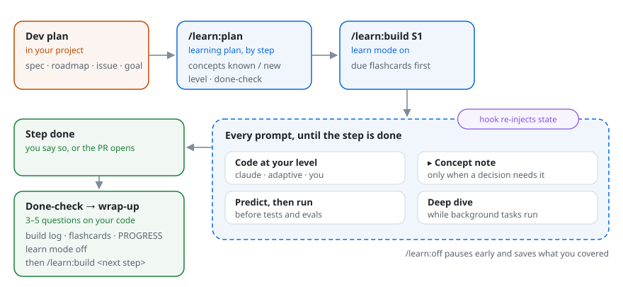
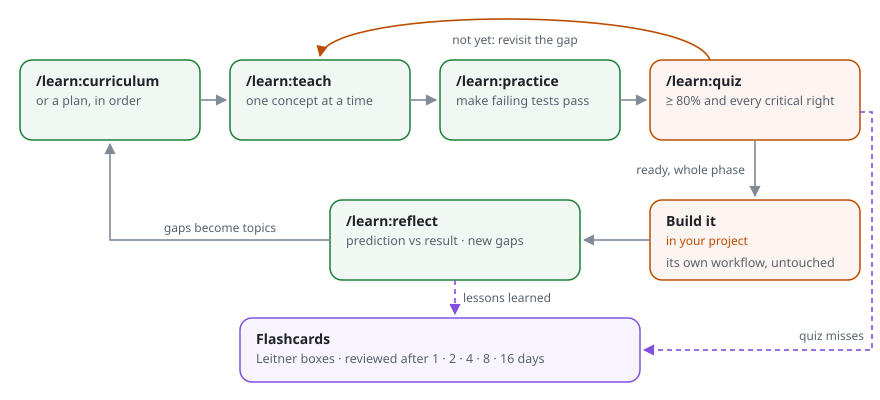
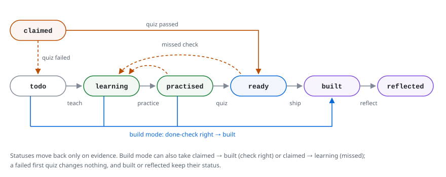

# The learning workflow

## The problem

Learning while you work usually looks like this: you hit something unfamiliar, ask for an explanation, nod along, and move on. A week later it's gone, and you can't tell what you actually understand from what you only recognise. The opposite extreme, a course, teaches things in an order that has nothing to do with what you need next.

This workflow sits between the two. It teaches **what your next piece of work needs, in the order you'll need it**, and it checks that you can *do* each thing, not just that you've read about it.

## Why a separate learning repo

Learning material is personal, exploratory and full of half-right attempts. Project repos are shared, reviewed and must stay clean. Keeping them apart:

- lets you study freely without polluting a team's history or exposing your gaps in a work repo;
- lets one subject draw on several projects at once: a pattern met at work can be practised on a side project;
- keeps the lessons with you when you leave a job or archive a project.

| Repo | Holds | Visibility |
|---|---|---|
| `learning-workflow` (plugin) | The method: skills, templates, docs | Public |
| Learning repo, one folder per subject | Your curriculum, lessons, exercises, deck, reflections | Private; a private GitHub remote is recommended so it syncs across machines |
| Projects | Real code and data, unchanged | As they were |

The learning repo reads projects; nothing reads the learning repo. Anything you learn that should reach a project is rewritten there through that project's own workflow (spec, branch, PR, review).

## Two ways to learn

| | Build mode | Study loop |
|---|---|---|
| When | You have real work to do now | Before the work, or for a deep concept |
| Where | In the project session | In the subject's folder of the learning repo |
| Driven by | A learning plan linked to the dev plan (`/learn:plan`) | A curriculum (`/learn:curriculum`), or the same learning plan studied in order (`/learn:teach <plan>`) |
| Teaching | Short concept notes only when a decision needs them; deep dives during background waits | Full lessons with labs |
| Checking | Predictions before runs; done-check when the step is done | Exercises with tests; quizzes |
| Shared | The subject's folder, flashcard deck, `PROGRESS.md` | ← same |

Verdict: start with build mode for most work; reach for the study loop when build mode flags a `deep` concept or you're new to the subject. The two meet in the plan: `/learn:teach <plan>` studies its concepts in order, `/learn:plan <plan>` shows which are taught, ready or still to do, and `/learn:build <step>` then only recalls what you already studied.

### Build mode

<picture>
  <source media="(prefers-color-scheme: dark)" srcset="diagrams/build-mode-dark.svg">
  
</picture>

**Hands-on levels.** `claude` (Claude codes and explains the decisions that matter), `adaptive` (Claude writes the plumbing and leaves you the core with a marked gap), or `you` (you code, Claude coaches). There's a default per subject, and any step or prompt can override it.

**Why it works.** Concepts arrive exactly when a decision depends on them (just in time). Predictions before runs exercise the generation effect. The done-check is retrieval practice on your own code. Misses feed the same spaced-repetition deck.

## The study loop

<picture>
  <source media="(prefers-color-scheme: dark)" srcset="diagrams/study-loop-dark.svg">
  
</picture>

1. **Curriculum.** The source is split into topics ordered by dependency, each tied to the phase that needs it, each with 2–3 observable "ready when" abilities. A short self-assessment skips what you already know (it gets a quiz instead of a lesson).
2. **Teach.** One concept at a time, with a question after each step: pick an option or type your own, with the data it needs shown beside it. Each lesson opens with its own small example, re-shown in full whenever a question builds on it. Before every lab run you predict the result. The lesson file is written as you go, by a background agent so you never wait on it, and records the explanation that actually worked for you.
3. **Practice.** Exercises with stubs and failing tests. The tests are checked against a hidden reference solution first, so a green run means you're right. Hints come one rung at a time; the solution only if you ask.
4. **Quiz.** Adaptive, one question at a time, mixing explain, predict-the-output, spot-the-bug and choose-and-justify. Ready means ≥ 80% **and** every critical question right.
5. **Build.** In the real project, with its normal process. The plugin stays out of it.
6. **Reflect.** What you predicted, what happened, why they differed, what to do differently. New gaps become new topics.
7. **Review.** Misses and key ideas become flashcards, reviewed on a Leitner schedule.

## The principles, and the evidence behind them

| Principle | How the skills apply it | Why |
|---|---|---|
| **Learn just in time** | Topics come from the plan you're about to execute; in build mode, a concept appears when a decision needs it | Motivation and transfer are highest when the use is immediate |
| **Predict, then run** | Every lab and many quiz items ask for a prediction first | Generating an answer before seeing it (the *generation effect*) and confronting a wrong prediction both improve retention |
| **Retrieval over rereading** | Quizzes, flashcards, "check" questions; flashcards are picked from near-miss options, so you still have to recall which one is right | *Retrieval practice* (the testing effect) beats rereading for long-term retention |
| **Spaced repetition** | Leitner boxes at 1, 2, 4, 8, 16 days | Spacing reviews out beats massing them (the *spacing effect*) |
| **One concept at a time** | Socratic pacing, a check after each step | Limits cognitive load; misconceptions are caught early |
| **Mastery gates** | "Ready when" + quiz threshold before building | Moving on with gaps compounds them |
| **Reflection** | Prediction-vs-result after every build | Turns experience into transferable lessons |
| **Numbers come from code** | Labs print what the lesson quotes | You never memorise a figure the tutor made up |

Further reading: Brown, Roediger & McDaniel, *Make It Stick* (2014); Dunlosky et al., "Improving Students' Learning With Effective Learning Techniques", *Psychological Science in the Public Interest* (2013).

## Statuses

Topics (study loop) and concepts (build mode) share one status set. Plan **steps** have their own: `todo` → `in progress` → `done`. Statuses move back only on evidence. A failed quiz on a `claimed` topic sends it to `todo`; a failed re-check of a `ready` topic sends it to `learning`; a failed first quiz leaves the topic where it is, with the gaps listed. A missed done-check question sends a concept to `learning`. Every miss becomes a flashcard. In build mode, a concept answered correctly in the done-check becomes `built`; one shown but not checked becomes at least `learning`; `built` and `reflected` concepts keep their status.

<picture>
  <source media="(prefers-color-scheme: dark)" srcset="diagrams/statuses-dark.svg">
  
</picture>

## Reproducibility

- Labs are self-contained programs in the repo's toolchain, with pinned dependencies and seeded data.
- Project citations carry a commit sha, so a lesson still points at the code it described after the project moves on.
- Every skill ends with a conventional commit, so the history is your learning log. With a remote, skills pull before they read and push after they commit, so every machine and session works on the same copy.
- `PROGRESS.md` is the one-page answer to "where am I?".
